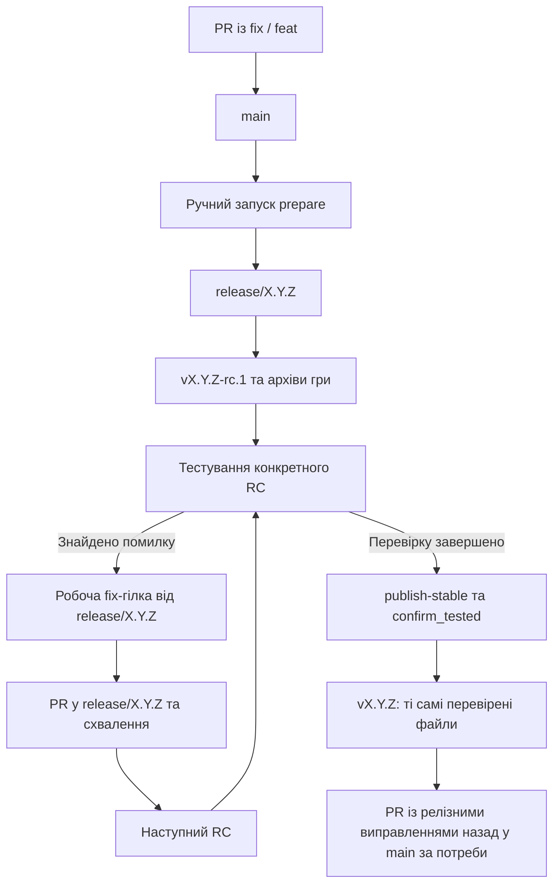

# Релізний процес

## Ролі main, релізної гілки й тегів

`main` об'єднує схвалені задачі. Коли потрібний набір змін готовий, workflow
**Releases** створює `release/X.Y.Z` від конкретного коміту `main` і збирає
кандидата `vX.Y.Z-rc.1`. Релізна гілка фіксує склад випуску, поки нова робота
продовжується в `main`.

RC — release candidate, тобто версія для тестування. Stable — перевірений випуск
із тегом `vX.Y.Z`. Теги позначають зафіксовані коміти й не пересуваються.
Злиття кожного PR у `main` не створює окремого релізу.



Одночасно підтримується один незавершений випуск. Гілку з номером версії
створює workflow; вручну створювати її для звичайного сценарію не потрібно.

## Що саме робить Release Please

У цьому репозиторії **Release Please 17.11.2 — бібліотека релізного контролера**,
а не окремо встановлений бот із release PR. Використовуються її парсер
Conventional Commits і стандартна стратегія підвищення SemVer.

Власний контролер [`.github/release/release.cjs`](../.github/release/release.cjs)
планує версію, створює гілку й теги, перевіряє маніфест та завантажує файли в GitHub.
Workflow [`.github/workflows/releases.yml`](../.github/workflows/releases.yml)
пов'язує ці операції зі збіркою Godot.

Контролер не відкриває release PR для погодження номера версії.
Опис релізу формується зі списку комітів без merge-комітів, включно з короткими SHA.
Окремий `CHANGELOG.md` поточна автоматика не створює й не оновлює.

## Версія одного випуску з кількох задач

Базою є найвища стабільна версія з тегів формату `vX.Y.Z`.
Під час `prepare` контролер читає всі коміти після цього тега до вибраного SHA `main`.
Якщо стабільних тегів ще немає, базова версія — `0.0.0`, а аналізується наявна історія.

Підвищення виконується **один раз за весь набір змін**, за найзначущішою зміною:

| Зміни після `v1.2.3` | Версія випуску | Перший RC |
| --- | --- | --- |
| Один або кілька `fix:` / `perf:` | `1.2.4` | `v1.2.4-rc.1` |
| Є `feat:` або `feature:` | `1.3.0` | `v1.3.0-rc.1` |
| Є несумісна зміна: `!` або `BREAKING CHANGE:` | `2.0.0` | `v2.0.0-rc.1` |

`chore:`, `docs:`, `ci:` та інші службові коміти самі по собі не запускають випуск.
Якщо є лише такі зміни, `prepare` завершиться повідомленням `No releasable changes`.
Ручне перевизначення через `Release-As` відхиляється.

До `1.0.0` діють ті самі правила: `feat:` після `0.1.0` дає `0.2.0`,
несумісна зміна — `1.0.0`. Для початкового `feat:` від бази `0.0.0` отримаємо `0.1.0`.

У гілці задачі може бути кілька `fix` і `feat` комітів. Звичайний merge зберігає
їх у релізній історії. При squash підсумковий коміт має містити коректний
Conventional Commit із найзначущішим типом зміни. Парсер також підтримує
додаткові Conventional Commit повідомлення в тілі коміту, наприклад:

```text
feat: add crystal collection

fix: correct respawn collision
```

## Підготовка кандидата

Після злиття потрібних задач у `main` і перевірки CI:

1. Відкрийте **Actions → Releases → Run workflow** в основному репозиторії.
2. Виберіть гілку **main**.
3. Для `action` залиште **prepare**. `candidate` і `confirm_tested` для цієї дії не потрібні.
4. Натисніть **Run workflow**.
5. Після завершення відкрийте посилання в підсумку запуску або сторінку **Releases**.

| Поле | Для prepare | Для publish-stable |
| --- | --- | --- |
| Гілка запуску | `main` | `main` |
| `action` | `prepare` | `publish-stable` |
| `candidate` | Не використовується | Точний тег перевіреного RC |
| `confirm_tested` | Не використовується | Має бути позначено |

Підготовка автоматично:

1. Перевіряє дозволеного користувача, гілку й стан попереднього stable.
2. Розраховує SemVer і перевіряє, що немає іншого незавершеного випуску.
3. Створює `release/X.Y.Z` від зафіксованого SHA `main`.
4. Запускає тести, експортує Windows/Linux, перевіряє запуск Linux-гри.
5. Пакує збірки й вихідний код, записує маніфест та SHA256.
6. Створює незмінний тег `vX.Y.Z-rc.1`, завантажує файли й публікує prerelease.

Невдала збірка не публікує готовий RC. Якщо помилка сталася під час
завантаження файлів, неповний GitHub Release залишається чернеткою.

## Файли RC та stable

| Файл | Вміст |
| --- | --- |
| `tyman-windows-x86_64.zip` | `tyman.exe` і `tyman.pck` |
| `tyman-linux-x86_64.zip` | `tyman.x86_64` і `tyman.pck` |
| `tyman-source.zip` | Вихідний код точного коміту з префіксом каталогу `tyman/` |
| `release-manifest.json` | Схема, репозиторій, версія, ім'я RC, SHA коміту й SHA256 трьох архівів |
| `SHA256SUMS` | SHA256 трьох ZIP-архівів |

Розпаковуйте весь архів своєї платформи: PCK має залишатися поруч із виконуваним файлом.
Тимчасові артефакти Actions доступні 14 днів; опубліковані файли RC завантажуються
зі сторінки GitHub Release й не залежать від строку зберігання цих артефактів.

Для перевірки контрольної суми у PowerShell:

```powershell
Get-FileHash -Algorithm SHA256 .\tyman-windows-x86_64.zip
```

Порівняйте результат із рядком цього архіву у `SHA256SUMS`.
У Linux можна перевірити одразу всі три завантажені архіви:

```sh
sha256sum -c SHA256SUMS
```

## Тестування та виправлення RC

Перевіряйте завантажені файли конкретного RC, а не поточний стан `main`.
Ручна перевірка має охоплювати запуск потрібної платформи, зображення,
рух WASD, стрибок, камеру, Esc/клік, повернення через R і збір усіх п'яти кристалів.
Автоматичні тести не оцінюють вигляд сцени або зручність керування.

Якщо знайдено помилку, створіть робочу гілку від відповідної релізної гілки:

```sh
git fetch origin
git switch -c fix/rc-respawn origin/release/0.1.0
# Виправте код, виконайте перевірки та створіть fix-коміт.
git push -u origin fix/rc-respawn
```

Відкрийте PR із `fix/rc-respawn` **у `release/0.1.0`**, отримайте схвалення
іншого власника коду й виконайте merge. Для fork використовуйте актуальну
`upstream/release/0.1.0` як основу, push — у свій `origin`, PR — в основний репозиторій.

Зміна релізної гілки автоматично запускає **Releases** і створює наступний RC:
`v0.1.0-rc.2`, `v0.1.0-rc.3` тощо. Базова версія `0.1.0` не змінюється.
Повторний запуск для того самого SHA використовує його попередній номер RC.

Після першого RC контролер відхиляє нові коміти типу `feat` / `feature` та
коміти з ознакою несумісної зміни. Нові можливості спрямовуйте в `main`.
Ця перевірка аналізує повідомлення комітів; зміст коду контролюють рецензенти.

Повторно створювати fork не потрібно: fork належить усьому репозиторію,
а для конкретного виправлення створюється лише нова робоча гілка.

## Публікація перевіреного stable

1. Завершіть тестування **останнього RC** потрібної версії.
2. Відкрийте **Actions → Releases → Run workflow** та виберіть **main**.
3. Для `action` виберіть **publish-stable**.
4. У `candidate` введіть точний тег, наприклад **`v0.1.0-rc.2`**.
5. Позначте **confirm_tested**, підтверджуючи перевірку саме цього RC.
6. Запустіть workflow та відкрийте посилання на stable у його підсумку.

Перед публікацією контролер перевіряє, що:

- операцію запускає дозволений користувач із `main` і перевірку явно підтверджено;
- RC повністю опублікований і має очікувані п'ять файлів;
- немає новішого опублікованого RC тієї самої версії;
- вершина `release/X.Y.Z` збігається з SHA вибраного RC;
- версія не нижча за останній stable;
- репозиторій, SHA, версія, назви файлів і всі контрольні суми відповідають маніфесту.

Далі створюється тег `vX.Y.Z` на **тому самому коміті**, а файли копіюються з RC
**без повторного експорту Godot**. Stable публікується як звичайний GitHub Release.
Маніфест зберігає ім'я протестованого RC: вміст файлів залишається ідентичним.

Якщо після тестування релізна гілка змінилася, старий RC опублікувати як stable
не вдасться. Дочекайтеся нового кандидата й перевірте його.

## Повернення виправлень у main

Якщо в релізній гілці з'явилися виправлення, яких немає в історії `main`,
після stable-публікації підсумок workflow міститиме посилання
**Open PR to merge release fixes back into main**.

Відкрийте PR за посиланням, отримайте схвалення та виберіть
**Create a merge commit**. Це зберігає stable-коміт у ланцюжку предків `main`.
Squash або rebase цього PR не гарантує збереження потрібного SHA в історії.

Наступний `prepare` перевіряє, чи є останній stable предком `main`.
Без цього підготовку нового випуску буде зупинено. Якщо релізних виправлень
не було й stable-коміт уже належить історії `main`, окремий PR не потрібен.
Релізні гілки зберігаються: вони потрібні для перевірок публікації.

## Доступ і захист

| Об'єкт або операція | Правило |
| --- | --- |
| Ручні `prepare` і `publish-stable` | Лише `qwer605` або `alx1115`, гілка запуску `main` |
| Репозиторій публікації | `qwer605/tyman`; у forks релізні jobs не запускаються |
| `main` та `release/*` | PR, щонайменше одне чуже схвалення, review власника коду; без винятків обходу |
| Схвалення після змін | Попередні approvals скидаються; останній push має схвалити інша особа |
| Власники всіх файлів | `@alx1115` та `@qwer605` із `.github/CODEOWNERS` |
| Теги `v*` | Нові можна створювати, наявні не можна оновлювати або видаляти |
| Збірка й тести | Дозвіл `contents: read`, без передавання токена публікації в ігрові тести |
| Планування й публікація | Окремі jobs із `contents: write`; контролер береться з `main` |

Використовується вбудований `GITHUB_TOKEN`; окремий PAT або секрет облікового запису
для цього процесу не потрібен. Дії GitHub закріплені за SHA комітів,
залежності Node.js — lock-файлом, рушій — `.godot-version`.

Перший RC будується в тому самому запуску, який створює релізну гілку:
подія push від вбудованого токена не потрібна для запуску наступного workflow.
Подальші RC запускаються після звичайного merge виправлень у релізну гілку.

Загальне право GitHub Actions створювати й схвалювати PR для цього процесу
не потрібне й не вмикалося. PR із поверненням виправлень відкриває людина за посиланням.
Workflow не виконує автоматичного схвалення або автоматичного merge.

## Відновлення після помилок

| Повідомлення або ситуація | Що зробити |
| --- | --- |
| `No releasable changes` | Перевірте наявність після останнього stable комітів `fix:`, `feat:`, `perf:` або несумісної зміни |
| `An unfinished release already exists` | Продовжуйте наявний RC через PR у його релізну гілку |
| `The release branch moved` / `branch changed` | Використайте запуск для актуального SHA й протестуйте новий RC |
| `New features or breaking changes must go to main` | Перевірте вміст і тип коміту; нові можливості належать наступному випуску з `main` |
| `Merge the last stable release branch back into main` | Злийте PR із релізними виправленнями через звичайний merge-коміт |
| `Confirm that you tested this exact candidate` | Перевірте вибраний RC і позначте `confirm_tested` |
| Помилка checksum або інший вміст уже завантаженого файла | Не змінюйте тег або файли опублікованого RC; з'ясуйте причину невідповідності |
| Збій тесту, експорту або завантаження | Перегляньте журнал, усуньте причину та використайте **Re-run failed jobs** |

Неповний реліз залишається чернеткою. Повторний запуск дозавантажує файли
лише за умови, що вже наявні файли збігаються байт у байт.
Теги не перезаписуються. Якщо під час повторної збірки файли змінилися,
контролер відхилить заміну — однаковий SHA не скасовує перевірку самих файлів.

Повторний `prepare` для незмінного SHA використовує ту саму гілку й RC.
Якщо `main` уже змінився, завершуйте поточний випуск через релізну гілку.
Операції **Releases** виконуються зі спільною групою concurrency:
новий запуск не скасовує вже активне завантаження файлів.

## Оновлення інструментів

Версія Godot задається в [`.godot-version`](../.godot-version).
Release Please зафіксовано в
[`.github/release/package.json`](../.github/release/package.json) і
[`package-lock.json`](../.github/release/package-lock.json).
Контролер імпортує парсер і стратегію з внутрішніх модулів пакета `build/src`;
оновлення пакета потрібно супроводжувати запуском усіх його локальних тестів.
Зміну версії рушія перевіряйте імпортом, тестами та експортом обох платформ.

Загальний перелік функціоналу: [Можливості проєкту](features.md).
Налаштування середовища та команди CI: [Розробка й перевірки](development.md).
